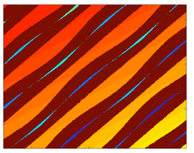
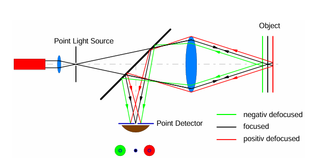
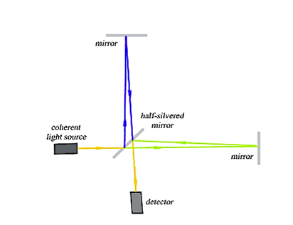

In previous research on Optical Audio Reconstruction (OAR), different methods have been tested however they all follow a similar procedure that involves the grooves on the record being scanned, then the groove undulations (tiny wave pattern along the groove path) are isolated and extracted before these undulations are converted into audio. Iwai et al. and Nakamura et al researched a method involving shining a laser beam onto the grooves and the undulations are processed using the measured angle of the reflected light. Errors were recorded using this method that stemmed from the laser beam missing a groove entirely, also laser beams have a finite width, and as undulations are incredibly small, it has been reported that a laser beam is too thick to properly measure an undulation resulting in simultaneous high and low frequency noise in the reconstructed audio signals. Fadeyev and Haber produced a method that involved the use of confocal laser scanning microscopy scanning surface height along the record and producing a 3D image, and using 2D edge detection the boundaries of the grooves can be traced meaning the groove undulations can be recorded. Stotzer et al. created a method involving a 2D analogue camera rapidly photographing the record with these images stored on film. This film is then digitised into 2 digital images. During scanning, the film sits on a rotating tray with a stationary overhead camera. The camera is only able to see a small window at a time and imaging of the grooves pass through this window. By doing this the curved grooves from the record are straightened out in the images making it easier to analyse. Edge detection is then used again for extracting the groove undulations.

In imaging, three distinct sections can be seen; tops, valleys and bottoms. And before the groove undulations can be extracted, these 3 regions need to be identified. This is done through height thresholding where each pixel of the image has a recorded height so therefore a cutoff can be set so each pixel can be labelled either a top or a bottom. Also, based on the geometry of how tops, bottoms and valleys work, a bottom will always be sandwiched by two valleys and a top and valley will never sandwich each other. So in figure 1, it can be seen that the narrow blue sections are the bottoms, the red sections are valleys and the orange sections are tops.

Figure 1: Topview of a groove image

To then extract audio, an edge detection algorithm is used to find the inner and outer top edges aswell as the groove bottom for each field of vision. These are then matched up for where neighbouring FOVs overlap, and spiral grooves are unwrapped into a straight line. This gives us three measurable signals, the two edge wiggles and the depth wiggles. The two edge signals are averaged to create one signal, T which follows the centre of the groove. Records are cut a constant velocity, so sound is carried by how fast the groove moves, not by position. So the software takes the numerical derivative (change from point to point) of the centre position signal and depth signal.

- Left = ΔT − ΔD

- Right = ΔT + ΔD

Then a RIAA filter is applied to restore original bass and treble balance as when the record is cut, bass turns down and treble turns up.

[OPTICAL AUDIO RECONSTRUCTION FOR STEREO PHONOGRAPH... - Google Scholar](https://scholar.google.com/scholar?hl=en&as_sdt=0%2C5&q=OPTICAL+AUDIO+RECONSTRUCTION+FOR+STEREO+PHONOGRAPH+RECORDS+USING+WHITE+LIGHT+INTERFEROMETRY&btnG=)

If groove bottoms are assumed to be parabolic, the equation for predicted height at position x can be given:

$$H_{k}(x) = Ax^{2} + Bx + C$$

A is a fixed constant as the same tool cut will be used for each groove meaning the curvature should be the same for every groove. B and C can vary as they describe where the groove is and how deep it is.

The depth $d_{k}$ at each angular step becomes the audio sample. So by fitting 11 points to a constrained parabola we get sample that is much less noisy compared to a single lowest point, especially since dust or possible damage can cause false low points to be read.

$$\chi_{k}^{2} = \frac{1}{\sigma^{2}}\sum_{i = l - 5}^{l + 5}\left\lbrack h_{ij} - H_{k}\left( x_{ij} \right) \right\rbrack^{2}$$

k is the index of the groove valley being fitted. j is the angular slice, held fixed. Each slice is one line scan along the cylinder axis. l is the raw-data index of the lowest point found for valley k. $x_{ij}$ and $h_{ij}$ are the position along the axis and the measured surface height at point i. $H_{k}(x)$ is the parabola. A is fixed, while $B_{k}$ and $C_{k}$ are free. $\sigma$ is the assumed measurement error per point, 0.22 µm, taken from the spread of fit residuals. $\chi_{k}^{2}$ describes how well the parabola matches to the chosen points and is desired to be as small as possible. Equations for groove depth $d_{k}$ and position $x_{k}$ are also given.

$$d_{k} = C_{k} - B_{k}^{2}/(4A)$$

$$x_{k} = - B_{k}/(2A)$$

The groove shape directly ties into the sound produced. At a pure tone, grooves are cut as sine waves. It’s sideways position is given as $x(t) = A\sin(2\pi ft)$, where A is the amplitude of the grooves wiggle, f is how many wiggles pass the stylus in one second and the velocity is the rate of change of position. Differentiating this results in:

$$v(t) = \frac{dx}{dt} = 2\pi fA\cos(2\pi ft)$$

Cosines peak at 1 so $v_{MAX} = 2\pi fA$. Which can be rearranged for maximum amplitude of the groove wiggle.

$$A_{MAX} = \frac{v_{MAX}}{2\pi f}$$

A note that changes pitch has a frequency that varies with time. If this change is slow which is usually the case for musical notes, then frequency can be treated as locally constant. Making the above equation a good approximation from moment to moment.

**Important to note: Only equation for max amplitude of the groove wiggle is given in literature, derivation was done manually with accompanying notes.**

It is useful to perform 3D scans of the surface of the record. This can be done through scanning confocal microscopy. The basic setup to this is shown in the figure below.

It involves a light source focusing onto one spot on a sample, the reflected light is also focused onto a second pinhole that is in front of a detector. Optics are adjusted so surface sits at the lens focal point and light will reflect as a direct beam, whereas when height changes over grooves, the surface will be slightly too close or too far away meaning the light will return as more of a spread out blur at the pinhole, meaning some of the light will be blocked and the detector will receive weaker signals. So the focusing optics can be adjusted and the position at the maximum detected signal can be recorded. Apparatus is then moved to the next spot and the process is repeated, building up a continuous height map.

Another method can also be used involves the use of a spectrometer instead of a standard photo detector. Rest of the setup is the same as previously. White light shone through a pinhole onto a sample surface, reflected light shines through second pinhole at a spectrometer that can measure how much light arrives at each wavelength. When the light hits the surface, only the colour whose focal point lies exactly on the surface will pass through the second pinhole completely, as different colours with different wavelengths will come into focus at different depths. So the reflection of other colours will scatter more and not pass through the second pinhole. The spectrometer will see a sharp peak for one wavelength and as each wavelength will correspond to a known focal depth, height can be recorded and this process repeated to create the desired height map.

The following equation can be used to estimate the time taken T_SCAN to scan the surface area, from the continuing process of scanning patches and stitching them together. 

$$T_{\text{SCAN}} = \frac{\text{AREA}}{\text{FOV}} \ t_{\text{MEAS}} + \text{shift}$$

FOV represents the field of view, so the area captured in one capture. t_MEAS represents the time taken for one measurement. Shift represents the time taken to move to the next position.

[Reconstruction of mechanically recorded sound from an edison cylinder using three dimensional non-contact optical surface metrology](https://escholarship.org/content/qt6qk9j5sx/qt6qk9j5sx.pdf)

Another method to reconstructing the groove undulations is through white light interferometry. Interferometry is a method for measuring tiny physical quantities by using light waves. It involves measuring the shape and texture of a surface using light and is built on the scientific principle of optical interference. This is for in the event that two lights meet, their wavelength peaks line up and will cause the resulting light to be brighter and if a peak meets the trough, then the resulting light is darker, this known as constructive or deconstructive interference. The pattern of light and dark bands from a reflected light depends on how much further a light beam has travelled. So, by reading the pattern, you can work out movements, vibrations or distances. This has many applications, such as the testing of optical systems, measurements of gas flows, plasmas and much more. The resulting intensity can be given as:

$$I = I_1 + I_2 + 2\sqrt{I_1 I_2}\cos(\Delta\varphi)$$

Where I_1 and I_2 are the separate intensities of the two beams of lights and ⁡∆φ is the phase difference between them. Phase difference can be given as:

$$\Delta\varphi = \frac{2\pi}{\lambda}\\Delta p$$

Where ∆p is given as the optical path difference, so how much farter one beam of light has travelled than the other, and λ gives the wavelength. So, if the wavelength of the light source is known, then the optical path difference can be derived from the interference pattern produced. To produce a valid interference pattern, some conditions need to be met on the experimental setup. First, the phase difference between the two beams must remain constant through the period of measurement. Secondly, wavelength, amplitude and frequency must be equal between the beams of light. Third, the electric field in the two beams of light must oscillate in the same direction. And fourth, the two beams should be nearly travelling in the same direction to ensure the wavefronts line up correctly. Below is a diagram displaying the basic setup for white light interferometry. 

So, in this example, a beam of light is projected onto a beam splitter, to produce two separate beams of light. The two beams are reflected twice, directing them in the same direction towards a detector. One beam of light will reflect off the reference surface, the other off the target surface. The interferometer will adjust the positions of the reference surface relative to the target surface to produce fringe patterns for each reference position. The optical path difference can be produced from the position of the reference surface relative to the target surface and the aim is to find the fringe pattern that produces an optical path difference of 0, and the surface height can subsequently be found from the position of the reference surface that produces this.

(https://mcgill.scholaris.ca/items/d67402ae-ba7e-401d-8ac3-373581c4566d) 
