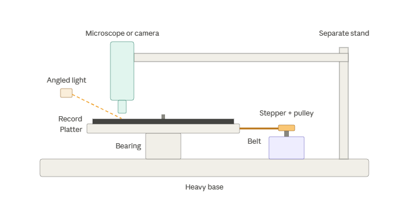
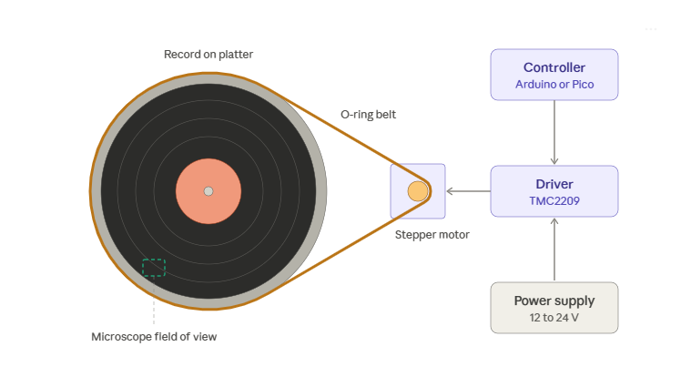

# Full Equipment List

- Stepper Motor (possibly NEMA 17) x1
- Driver (possibly TMC2209) x2
- Controller (Raspberry pi pico or arduino) x1
- Motor Power Supply (enclosed supply with screw terminals, 12V or 24V, 2A or more) x1
- Electrolytic Capacitor (100µF or larger & 35V or higher) x2
- Wiring (jumper wires & 20-22 AWG hookup wires) x1 set
- Breadboard or perfboard x1
- Inline Fuse (2-3A) and Holder x1
- Pin headers to connect wires to board
- Power Switch x1
- Small Heatsink for Driver x2 – commonly come included with driver
- USB cable to program and power the controller x1

**Estimated price range:** 10,000–20,000 yen

Some apparatus comes with built-in equipment, so the optimum combination is:

- Arduino Uno (headers built in)
- CNC Shield V3
- TMC2209 with headers pre soldered
- NEMA 17 stepper
- 12V enclosed supply with mains chord
- Inline fuse holder, switch and wago connectors
- Usb cable, hookup wires, fuses

## Setup

