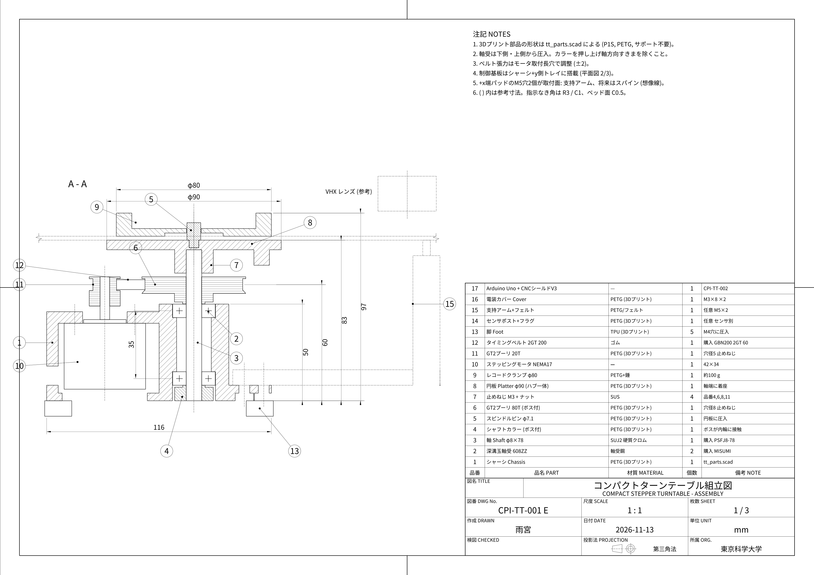
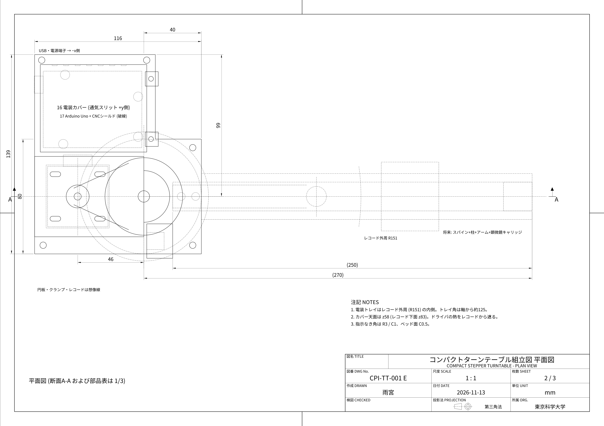
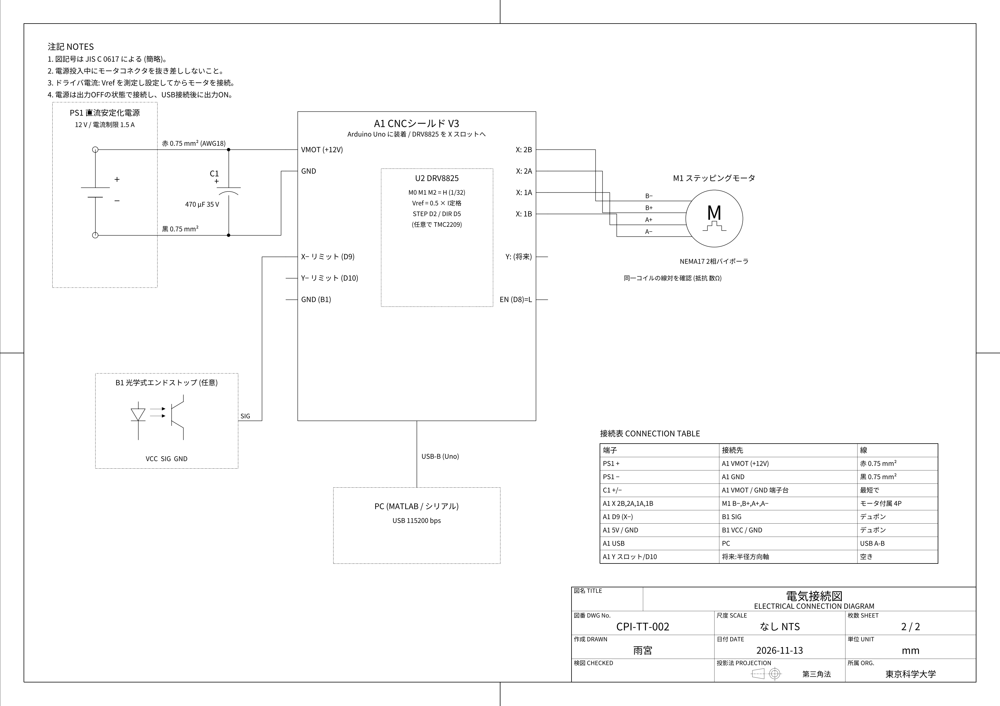

# Stepper turntable rig — design & build guide

Nov 13, 2026 · @雨宮葉流

## Overview

A palm-sized belt-drive turntable turns the record under the Keyence VHX
in 0.014° microsteps. It stops to dwell at each frame position, so every
capture is blur-free. The layout follows the [Audio-Technica AT-SB727
Sound Burger](https://www.zzounds.com/item--AUDATSB727?siid=336624), a
100 × 290 × 70 mm belt-drive body with a small platter: one narrow
chassis, a small platter, and the record overhanging. The Arduino and
CNC shield sit on a tray on the chassis's +y side, under a vented cover,
still beneath the record.

| Spec           | Value                                                                                                                                                                                                        | Why                                                                                                                                |
|----------------|--------------------------------------------------------------------------------------------------------------------------------------------------------------------------------------------------------------|------------------------------------------------------------------------------------------------------------------------------------|
| Footprint      | Chassis 116 × 139 mm including the electronics tray, record top about 93 mm above the table (with feet)                                                                                                      | Fits on the VHX stage; the record's overhang is free for imaging                                                                   |
| Drive          | NEMA17 → GT2 20T/80T, 4:1, 200 mm closed belt, 46 mm centres                                                                                                                                                 | Divides motor step ripple by 4; the belt damps vibration                                                                           |
| Resolution     | 200 × 32 × 4 = 25,600 microsteps/rev = 0.0141°                                                                                                                                                               | 32 µm of arc at r = 130 mm, about 6 px at 30×                                                                                      |
| Record support | Ø90 platter + Ø80 clamp grip the label area; optional felt-tipped skid on a printed arm at r = 120 mm                                                                                                        | The skid holds the overhang at a fixed height right under the lens                                                                 |
| Default motion | Index mode: move 1°, settle 0.3 s, dwell 0.5 s, repeat                                                                                                                                                       | 1° at the outer groove (r ≈ 146 mm) is 2.5 mm, a quarter of the 30× field width (10.2 mm), so each point is seen in about 4 frames |
| One revolution | 360 indices × ~0.9 s ≈ 5.5 min                                                                                                                                                                               | The VHX records video throughout; frames come from the dwells                                                                      |
| Bearings       | Two 608ZZ, 35 mm apart, ×8 steel shaft                                                                                                                                                                       | Radial play shows up as the spiral-centre offset e, which the fit already solves for                                               |
| Supply         | Bench supply 12 V, current limit 1.5 A                                                                                                                                                                       | 12 V keeps the DRV8825's smallest microsteps cleaner than 24 V                                                                     |
| Gantry-ready   | An 8 mm pad with 2 × M5 holes at the chassis's +x end. Later, a spine (2020 extrusion or a wood batten) bolts there and carries the radial axis's post and arm. Y slot and Y endstop on the shield left free | Nothing to buy until the axis is designed, and the turntable doesn't change when it's added                                        |

**Why index mode.** At 1 rev/min the outer groove moves about 15 mm/s. A
1/30 s exposure would smear that over roughly 100 px at 30×, so the rig
stops for every frame. The firmware logs each dwell with a timestamp and
step count, which gives Part A of the method a direct prior on θ for
each dwell.

**Open questions.**

- Check that the VHX stage has about 100 mm of clearance under the lens
  for the record top (93 mm) plus focus travel.

- The overhang will flutter and sag a little. If focus drifts at large
  radii, fit the support skid.

## Mechanical design

One printed chassis carries everything: the bearing housing at one end,
and the motor hanging face-up under a deck at the other, 46 mm away. The
drawing is CPI-TT-001 rev E, at the end of this section, with the
printed parts in tt_parts.scad. Heights below are measured from the
chassis underside.

| Height (mm) | Part                                                            | Notes                                                                                                                                                                          |
|-------------|-----------------------------------------------------------------|--------------------------------------------------------------------------------------------------------------------------------------------------------------------------------|
| 0–4         | Chassis base plate, 116 × 80                                    | Window under the motor so it fits from below; 8 mm pad at the +x end with 2 × M5 holes (skid arm now, spine later); M4 holes at the corners and for the sensor post            |
| 0–50        | Bearing housing (part of the chassis)                           | 608ZZ seats at 8–15 and 43–50: bearings 35 mm apart centre to centre                                                                                                           |
| 0–8         | Printed shaft collar with a 1 mm boss                           | Under the bottom bearing, which presses in from below. Push the shaft up before tightening to remove axial play; the boss touches only the inner race                          |
| 6–40        | NEMA17 under the deck (deck 40–46)                              | Pilot boss up into the deck, 4 × M3 × 8 from above through ±2 mm slots for belt tension                                                                                        |
| 51–64       | Printed GT2 80T on the shaft, printed GT2 20T on the motor      | Belt band 57–63 (centre 60); a 1 mm boss under the 80T hub bears on the top inner race and keeps the hub off the seal                                                          |
| 66–78       | Platter's printed clamp hub (Ø20), in place of a flange coupler | The shaft's top end seats against the platter underside, which keeps the platter square; one M3 set screw on a captive nut clamps it                                           |
| 78–83       | Platter ×90 with ×7.1 spindle                                   | Supports the label area only (an LP label is about ×100). The spindle is a printed pin pressed into the top face; a printed home flag presses into a slot underneath at r = 35 |
| 83–85       | Record                                                          | Overhangs the chassis by 100 mm or more on every side                                                                                                                          |
| 85–97       | Clamp puck ×80                                                  | About 100 g of M8 nuts or coins in its pocket sandwiches the label against the platter                                                                                         |

**Belt.** Pulley pitch diameters are 12.73 mm (20T) and 50.93 mm (80T).
A 200 mm closed belt gives the 46 mm centre distance:

L = 2C + \frac{\pi (D + d)}{2} + \frac{(D - d)^2}{4C} \\\Rightarrow\\ C
\approx 46\\ \text{mm for } L = 200

**Optional parts.**

- **Support skid arm.** Bolts to the pad's two M5 holes and reaches out
  to r = 120 mm. An M4 screw with a felt tip, set just touching the
  record's underside, stops sag and flutter where you image. The felt
  rubs the other side's grooves, so use it only on test records. For
  another radius, change skid_r in the .scad and reprint the arm.

- **Home sensor post.** Sits on the −y side at (8, −31), with the
  slotted optical endstop's slot at r = 35 under the platter's flag. It
  gives a repeatable zero angle between runs; image loop closure doesn't
  need it, so the sensor module isn't on the buy list. The post and flag
  are printed, ready if you add one.

**Electronics tray.** The base plate extends on the +y side into a tray
carrying the Uno and CNC shield on four printed 6 mm standoffs. The tray
stays inside the record's radius: its far corner is about 125 mm from
the axis, against the record's 151. The USB and DC jacks and the
shield's supply terminal face the −x end, and the motor cable passes
through a slot in the motor block's +y wall. A printed cover (part 16)
sits over the stack, with its solid top at z = 58, 25 mm under the
record. That top deflects the DRV8825's warm air away from the vinyl,
which softens at about 60 °C. Vents run along the cover's +y side, its
−x end is open for cables, and two M3 screws hold it, so it comes off to
set Vref.

**Gantry-ready: the pad.** The chassis's +x end has an 8 mm pad with two
M5 holes, 10 mm apart (counterbored from below). That pad is the whole
interface, and it costs only plastic. When you build the radial axis, a
spine bolts to it: a 2020 extrusion or a hardwood batten, about 250 mm
long, running at z 8–28 under the record and out past its edge (r =
151). A post on the spine's end and an arm back over the record then
carry the microscope from r ≈ 50 to 150 mm. The drawing shows this in
phantom lines. The shield's Y slot (STEP D3, DIR D6) and Y− endstop
(D10) stay free for its motor.

**Fits to tune.** Bearing seats print at ×22.15 for a light press fit,
and the spindle at ×7.1 against the record's 7.24 mm hole. Print one
chassis, test the fits, and adjust brg_seat_d / spindle_d at the top of
the .scad file before a final print.

**Printability and finish (checked on the exported meshes).** All twelve
printed parts are closed, watertight solids and fit the P1S's 256 mm
build volume (the largest is the chassis, 116 × 139 × 50 mm). The cover
sits on the tray without overlapping the chassis anywhere. An overhang
scan finds nothing steeper than 45° except deliberate bridges: the motor
deck (44 mm), the two cable slots (12 and 20 mm), the M5 counterbore
ceilings, and the clamp's 0.4 mm relief. To print without supports, the
bottom bearing seat ends in a 45° cone instead of a flat ceiling, the
sensor pad sits on a gusset, the flag and spindle are separate parts,
and each pulley's lower flange is a 45° cone so it prints top flange
down. For looks, outside vertical edges are rounded at R3 (R4 on the
base plate), top edges chamfered at 1 mm, and every edge on the bed
chamfered at 0.5 mm, which also hides elephant's foot. Bearing seats,
the pilot hole and the screw holes have small lead-in chamfers.

**Printed drive parts.** Both GT2 pulleys, the shaft collar and the
platter hub are printed, and each clamps the shaft with one M3 set screw
on a nut dropped into a slot. The 1 mm bosses on the collar and the 80T
hub touch only the bearings' inner races, so no shim rings are needed.
The tooth groove is a U shape sized to the 2GT belt (gt2_r in the
.scad): if the belt rides high or binds, adjust it by 0.05 mm and
reprint. Small tooth errors only add a slight once-per-turn wobble to θ,
which the image fit corrects. If the printed 20T is too rough, a MISUMI
2GT 20T pulley (bore 5) drops in with the same geometry.

CPI-TT-001 rev E, assembly drawing (A3, 1:1, third-angle projection).
Sheet 1/3: section A–A through the shaft and motor axes, with the parts
list numbered upward from the title block. Sheet 2/3: plan view with the
electronics tray and cover, and the future radial axis in phantom lines.

## Electronics

The bench supply feeds the CNC shield at 12 V. A DRV8825 in the X slot
drives the motor, and the Uno talks to the PC over USB. Drawing
CPI-TT-002 (end of this section) shows the circuit with JIS C 0617
symbols.

| From                           | To                                           | Wire / setting                                                                                    |
|--------------------------------|----------------------------------------------|---------------------------------------------------------------------------------------------------|
| Bench supply +                 | Shield VMOT (+12 V) screw terminal           | Red, 0.75 mm² (AWG18); 12 V, current limit 1.5 A                                                  |
| Bench supply −                 | Shield GND screw terminal                    | Black, 0.75 mm²                                                                                   |
| C1 470 µF 35 V                 | Across VMOT / GND at the terminal, + to VMOT | Shortest possible leads                                                                           |
| Shield X header 2B, 2A, 1A, 1B | Motor B−, B+, A+, A−                         | Motor's 4-pin cable. Check the coil pairs with a meter: a few Ω within a pair, open between pairs |
| Shield X− limit (D9)           | Optical endstop SIG                          | Dupont; endstop VCC and GND to the shield's 5 V and GND                                           |
| Uno USB-B                      | PC                                           | 115200 baud                                                                                       |
| Shield Y slot, Y− (D10)        | Spare                                        | For the radial axis later                                                                         |

**Driver settings (DRV8825 in the X slot).**

- Microstepping: all three jumpers (M0, M1, M2) on = 1/32.

- Current: Vref = 0.5 × motor rated current for a 0.1 Ω sense resistor
  (marked R100). Set it before connecting the motor, to 70–80% of the
  rating.

- Enable: D8 is held LOW by the firmware.

- A TMC2209 drops into the same slot later: leave M2 off, set Vref ≈
  1.41 × current. No firmware change is needed.

**Power-up order.** Supply output off → connect everything → plug in USB
→ supply output on. Never unplug the motor with the output on: the
coil's inductive kick can kill the driver.

**Where it lives.** The Uno and shield sit on the chassis tray (see
Mechanical design), with the DRV8825's heatsink under the cover's solid
top. Keep the supply leads and USB cable leaving from the −x end, away
from the imaging side.

CPI-TT-002, electrical connection diagram (A3, not to scale), with the
connection table.

## Firmware

tt_firmware.ino generates step pulses from a hardware timer (Timer1) at
an even rate, with trapezoidal ramps. That steady timing matters more
for smooth images than anything in the driver. It compiles to about 10
KB, 31% of the Uno's flash. tt_run_index.m runs a scan from MATLAB and
writes one CSV row per dwell.

| Command                                             | Does                                                                        |
|-----------------------------------------------------|-----------------------------------------------------------------------------|
| I \<step_deg\> \<dwell_ms\> \<count\> \[settle_ms\] | Index mode: move, settle (default 300 ms), dwell, repeat. count 0 = until S |
| V \<deg/s\>                                         | Continuous rotation, signed; V 0 ramps down                                 |
| M \<deg\> / A \<deg\>                               | Relative / absolute move                                                    |
| H                                                   | Home: turn slowly until the flag enters the sensor, zero there              |
| Z / P                                               | Set zero / print position                                                   |
| R \<deg/s\> / C \<deg/s²\>                          | Max speed (default 20) / acceleration (default 40)                          |
| S / X                                               | Ramped stop / immediate stop                                                |
| E 0 / E 1                                           | Driver off / on                                                             |

**What it sends back.** Every line is comma-separated with a millisecond
timestamp. DW,\<t\>,\<steps\>,\<n\> marks the start of dwell n: grab
frames there. MV and DN mark motion start and end. Steps convert to
angle as θ = steps × 360 / 25600.

**Syncing with the video.** The VHX clock and the Arduino clock are
independent. Match the first MV to the first frame where the image
starts to move, and every later dwell follows from the log. That gives
Part A an initial θ_k for each dwell, in place of phase-correlation
initialisation.

**Constants to check** at the top of the sketch: MICROSTEPS (32), RATIO
(4), HOME_ACTIVE_HIGH (your sensor's output when blocked), and
DIR_INVERT (so that + is counter-clockwise seen from above).

## Build steps

1.  **Print** from tt_parts.scad on the P1S in PETG (0.4 nozzle, 0.2 mm
    layers, 4 walls, 40% gyroid, chassis 60%). No part needs supports;
    the exported STLs are already in print orientation: chassis base
    down, platter record seat down (hub up), spindle pin upright, collar
    boss up, both pulleys top flange down, feet pin up (TPU, or PETG),
    home flag flat, clamp rim down, sensor post upright, cover top down,
    and skid arm. Export each part with openscad -D 'part="chassis"' -o
    chassis.stl tt_parts.scad; the STL files are included. The only real
    bridge is the motor deck, 44 mm between the side walls: turn on
    thick bridges in Bambu Studio. Press the spindle pin into the
    platter's top face and the flag 3 mm into the slot underneath, with
    a drop of glue if either is loose. Drop an M3 nut into each hub's
    slot (collar, both pulleys, platter).

2.  **Prepare the shaft.** The Ø8 shaft arrives cut to 78 mm (MISUMI
    PSFJ8-78). File a 0.5 mm flat 51–56 mm from the bottom end for the
    80T's set screw.

3.  **Fit the bearings.** Press the bottom 608ZZ up into its seat from
    below until it stops on the cone shoulder, and the top one down into
    its seat from above. Use a bolt, two washers and a nut as a press,
    not a hammer. Slide the shaft down through both.

4.  **Remove axial play.** Slide the 80T pulley (hub down, set screw on
    the flat) onto the shaft above the top bearing and the collar (boss
    up) on from below. Push the shaft up until the 80T's boss seats on
    the top inner race, tighten its set screw, then push the collar up
    against the bottom inner race and tighten it. It should spin freely
    with no up-and-down play.

5.  **Fit the drive.** Fit the 20T on the motor shaft, flush with the
    shaft's end, with its set screw on the shaft's flat.

6.  **Fit the motor.** Put the belt over the 80T pulley. Insert the
    motor from below through the window, pilot up into the deck, and
    loop the belt over the 20T. Fit 4 × M3 × 8 from above. Slide the
    motor toward −x until the belt deflects about 1 mm under light
    finger pressure, then tighten.

7.  **Fit the platter.** Push its hub down over the shaft until the
    shaft's end seats against the platter, then tighten the set screw.
    Check the run-out with a dial gauge or under the VHX at the
    platter's edge, and re-seat the platter if it wobbles more than
    about 0.1 mm.

8.  **Fit the feet and options.** Press the 5 printed feet into the
    base's M4 corner holes from below. Optionally fit the sensor post at
    (8, −31) with the endstop's slot under the flag, and the skid arm on
    the +x pad (2 × M5 × 16 from below, nuts on top).

9.  **Wire it** per CPI-TT-002: supply → shield terminal with C1, motor
    to the X header, endstop to X−. Screw the Uno to the tray's
    standoffs (4 × M3 × 6 self-tapping) and plug the shield on. Route
    the motor cable through the slot in the +y wall, then fit the cover
    with 2 × M3 × 8.

10. **Flash** tt_firmware.ino from the Arduino IDE (board: Arduino Uno),
    then open the Serial Monitor at 115200 baud and look for
    READY,25600,steps/rev.

## Setup and calibration

1.  **Set the current with the motor unplugged.** Turn the supply output
    on at 12 V with a 1.5 A limit. Measure Vref between the DRV8825's
    trimmer and GND, and set it to 0.5 × rated current × 0.75 (for
    example 0.56 V for a 1.5 A motor). Turn the output off.

2.  **Check the jumpers:** M0, M1 and M2 all on under the X slot.

3.  **Connect the motor, output on.** Send M 90. The platter should turn
    a quarter turn counter-clockwise seen from above. If it turns the
    other way, set DIR_INVERT = true and re-flash.

4.  **Check steps per degree.** Mark the platter edge, send M 360 ten
    times, and compare. Any drift means lost steps (raise current or
    lower R) or belt slip (more tension).

5.  **Home sensor (if fitted).** Send H; it should report HOME,…,ok
    within one revolution. If it stops at once, the sensor logic is
    inverted: flip HOME_ACTIVE_HIGH.

6.  **Skid height (if fitted).** With a record clamped, raise the arm's
    felt-tipped screw until it just touches the record underside at r =
    120 mm, then back it off 1/8 turn. The record should turn without
    the screw lifting it.

7.  **Settle time.** Under the VHX at the working magnification, run I 1
    1000 20 0 and watch the image after each move. Set the settle time
    to when the image stops moving, plus a margin (start at 300 ms).

## Acceptance tests and troubleshooting

The rig is ready for data when all four tests pass.

| Test            | How                                                           | Pass                                                          |
|-----------------|---------------------------------------------------------------|---------------------------------------------------------------|
| Repeatability   | M 360 × 10, check the mark (or H then P between runs)         | Back within 0.05° (4 microsteps)                              |
| Run-out         | VHX on the platter's edge, slow V 2 for one turn              | Under 0.1 mm of focus change and of radial shift              |
| Blur-free dwell | I 1 500 10 at 30×, step through the video frames              | Groove edges sharp in every dwell frame after the settle time |
| Smoothness      | V 1 at 30×; phase-correlation motion trace from your pipeline | No ripple at the step frequency or its ½ and ¼ harmonics      |

| Symptom                      | Likely cause                                       | Fix                                                       |
|------------------------------|----------------------------------------------------|-----------------------------------------------------------|
| Motor buzzes, doesn't turn   | Coil pairs crossed                                 | Swap the middle two motor wires                           |
| Lost steps, positions drift  | Current too low, ramp too steep, belt slipping     | Raise Vref toward the rating, lower R/C, add belt tension |
| Driver hot or cutting out    | Current too high, no heatsink                      | Lower Vref, fit the heatsink, add a small fan             |
| Image jitters while moving   | Microstep error at low speed                       | Check the 1/32 jumpers, stay at 12 V, try the TMC2209     |
| Focus drifts at large radius | Record sag or warp                                 | Fit the skid arm, with skid_r set to your imaging radius  |
| Platter wobbles              | Platter not seated on the shaft end, or axial play | Re-seat the platter; redo the collar step                 |

## Parts list

Anything that can be printed is printed, so the buy list is two orders:
Amazon for the controller kit and motor, and MISUMI for the bearings,
shaft, belt and screws. It is in the [parts list
sheet](https://claude.ai/artifact/2ybU5fh8v67GFHu9vxT2Gt). Fill in
prices from your cart and the total updates. The capacitor and supply
leads come from the lab, and the home sensor, skid felt and TMC2209 are
left off until needed.

| Group         | Items                                                                                                                                                                   |
|---------------|-------------------------------------------------------------------------------------------------------------------------------------------------------------------------|
| Keep          | Uno + CNC shield + DRV8825 kit, NEMA17 42×34 with cable                                                                                                                 |
| Buy: drive    | 2GT closed belt 200 mm × 6 mm (GBN200 2GT 60); both pulleys printed                                                                                                     |
| Buy: bearings | 2 × 608ZZ, ×8 × 78 shaft, ordered cut (MISUMI PSFJ8-78); collar printed                                                                                                 |
| Buy: screws   | M3/M4/M5 screws and 4 × M3 set screws + nuts (MISUMI)                                                                                                                   |
| Printed       | Chassis (with tray), platter with hub, spindle pin, collar, GT2 80T and 20T pulleys, 5 feet (TPU), flag, clamp, electronics cover (+ optional sensor post and skid arm) |
| Have / borrow | Bench supply and leads, PETG/TPU, multimeter, 470 µF capacitor                                                                                                          |
| Optional      | Photo-interrupter for homing, skid felt, TMC2209 (not bought)                                                                                                           |

**Files.** CPI-TT-001_assembly and CPI-TT-002_electrical (DXF + PDF),
tt_parts.scad + STLs, tt_firmware.ino, tt_run_index.m.
